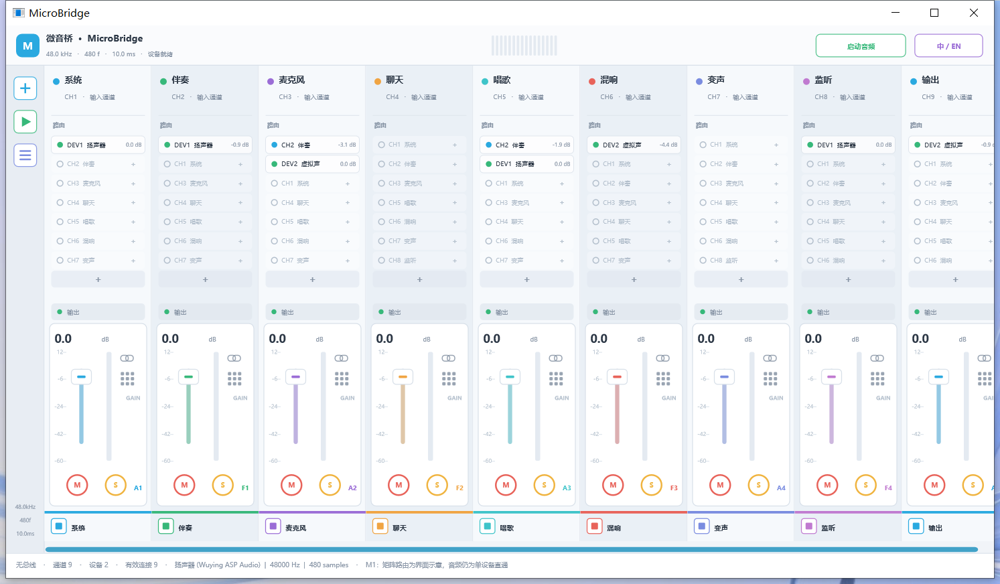

# MicroBridge / 微音桥

**[简体中文](README.zh-CN.md)** · English



> A lightweight **audio patchbay** for Windows. No fixed buses: every channel picks its own
> input sources and output targets, including every sound-card driver on the machine and
> other channels. It also ships a built-in media player, desktop lyrics, a built-in FX
> chain, global hotkeys, and a system-tray mode.

**Status: pre-alpha. Not production-ready.** Windows x64 only.

---

## Features

- **Software patchbay (not a mixer).** Routing is a directed, gain-weighted graph with three
  edge kinds — `P→C` (physical input → channel), `C→C` (channel → channel), `C→P` (channel →
  physical output). A→B→A feedback loops are rejected at connect time via topological cycle
  detection. Mute cuts all outgoing edges; solo keeps only soloed channels' outgoing edges.
- **Every local driver is a valid target.** The output menu lists the output ports of *all*
  enumerated drivers (not just the master device). Routing to a non-master driver opens it
  lazily as an auxiliary device; routing to another channel turns that channel into an input
  source. Auxiliary devices close automatically when nothing references them.
- **Driver selection at startup.** First launch shows a device panel listing all available
  driver types — **ASIO** (explicitly enabled in this build), **WASAPI** (shared / exclusive /
  low-latency) and **DirectSound** — with input device, output device, sample rate and buffer
  size. The choice persists to `%APPDATA%\MicroBridge\device.xml` and is restored on later
  launches. Audio starts as soon as a device is chosen and stops only when the app closes;
  there are **no Start / Stop controls**.
- **Built-in channel FX.** A single-effect panel and a chain mode covering
  **Noise Gate, High-Pass Filter (HPF), Equalizer (EQ), Compressor, Drive, Delay, Reverb,
  Limiter**. Per-effect `旁通` (bypass) and `重置` (reset) share a uniform, bottom-aligned
  layout on every built-in plugin.
- **Media player plugin.** Add the built-in **Player** to any channel to play audio files
  (MP3 / M4A·AAC / WMA / WAV / FLAC via Windows Media Foundation) straight through the
  routing graph. Playlist, previous / next, seek, and **background playback** (audio keeps
  running when the main window is hidden or closed to the tray).
- **Desktop lyrics.** A floating, always-on-top lyrics window that follows the current line's
  colour, supports drag / resize, auto font-scaling, and a **lock** mode (mouse pass-through
  so you can operate other apps through it). Hide / close buttons are synced with the player's
  desktop-lyrics toggle. Lyrics are read from embedded LRC metadata.
- **Global hotkeys.** Configurable system-wide shortcuts — lock / unlock desktop lyrics
  (default `Ctrl+Alt+L`) and hide / restore the window.
- **System tray.** Optional tray icon with hide-to-tray-on-close, start-minimized, and a
  quick lock / unlock lyrics entry.
- **Settings.** Always-on-top, desktop-lyrics on top, desktop-lyrics locked state, custom
  unlock / lock and hide hotkeys, hide mode, and an immediate `中 / EN` language switch.
- **Channel linking.** Link faders across multiple channels so they move together.
- **Session store, recorder, node view.** Save / restore the current patch, capture a channel
  to a file, and visualise the routing graph.
- **Bilingual UI.** Every string goes through `Source/I18n.h` (`S()` / `tr()`,
  `CharPointer_UTF8`); language switching is instant.

**Name:** 微 (micro = low footprint / low latency) + 音桥 (audio bridge). Three Chinese
characters, clean English `MicroBridge`.

## Design constraints

- **Lightweight:** no AI models, ONNX Runtime, Media Foundation *decoder* (only used for the
  player), or bundled virtual-audio driver.
- **C++20 + JUCE 8:** used for device I/O, threads, GUI and basic DSP. JUCE is **referenced,
  never copied** (see `JUCE_DIR`).
- **ASIO:** JUCE ships with `JUCE_ASIO=0` by default, so this build sets `JUCE_ASIO=1` and
  uses the bundled Steinberg ASIO SDK headers. **The ASIO SDK has its own licence terms** —
  review Steinberg's licence before redistributing binaries.
- **VST3 hosting** is compiled in (`JUCE_PLUGINHOST_VST3=1`) and exposed through a plugin rack,
  but the built-in FX above are the primary, self-contained DSP chain.
- **Independent of S-Rack:** this project only reads the existing JUCE source tree; it does
  not depend on, modify, or ship the S-Rack plugin or its models.

### Explicitly out of scope

Timeline, multitrack editing, undo history, offline render, recording editor, AI vocal
separation, driver installation, macOS / Linux.

## UI overview

- **Top bar:** brand, driver-type chip, sample rate / buffer / latency, master device,
  LED meter, an auto-running status dot, **Devices**, **中 / EN**.
- **Ribbon:** channel / input-port / output-port / edge / auxiliary-device / underrun counts,
  plus `+ Channel`, `Clear all`, `Reset`.
- **Channel strips** (horizontally scrollable), each with an **INPUT SOURCES** section
  (physical input ports + other channels, purple / blue dots), an **OUTPUT TARGETS** section
  (all local output drivers + other channels, green / blue dots), and a fader card
  (dB readout, meter, `M` / `S`). Click `+` to patch, click an existing row to change gain
  or remove. The **Player** and built-in **FX** live in the channel's plugin area.
- **Footer:** hint text and short-lived operation feedback.

> **Chinese encoding:** JUCE 8's `String (const char*)` constructs byte-by-byte as ASCII,
> so raw UTF-8 Chinese literals render as `微音桥`. Every UI string goes through
> `Source/I18n.h`'s `S()` / `tr()` (`CharPointer_UTF8`). Language switching is immediate.

## Architecture (short version)

`Source/RouteGraph.h` is pure C++20 with no JUCE dependency. The control thread builds the
graph, rejects cycles and compiles an immutable `ProcessingPlan`, published through
`atomic<shared_ptr<const Plan>>`. The audio callback only multiplies and accumulates —
no allocation, no locks, no graph traversal.

`Source/AudioEngine.h` runs the master device as the single processing clock. For each
auxiliary driver it creates a separate `AudioIODevice` and bridges it with an SPSC lock-free
ring buffer plus linear-interpolation resampling and slow drift correction (lightweight
ASRC). `Source/DeviceCatalog.h` enumerates driver types / devices / ports and persists the
default in/out choice.

Port mapping is published as another immutable snapshot (`PortRouting`), so the audio
thread never reads the mutable device catalogue. See [docs/ARCHITECTURE.md](docs/ARCHITECTURE.md).

## Known limitations

1. Each driver currently exposes **two stereo ports (L / R)**. Devices with more channels
   map to the first two; per-channel routing beyond stereo is future work.
2. Re-selecting a driver re-enumerates ports, so **routes are reset** (port ids change).
   Route presets / full persistence are still being hardened.
3. Multi-device clock drift is handled by interpolation + adaptive read position, but
   **long-run (30 min) drift and dropout behaviour still needs real-hardware validation**.
   Underrun / overflow counters are shown in the ribbon.
4. Some drivers refuse a second open (notably certain ASIO drivers). Those ports produce
   silence and the failure is reported in the UI rather than faked.
5. Auxiliary devices add roughly `max(1024, 4 × buffer)` frames of latency (~21 ms @48 kHz);
   the master device path has no extra buffering.
6. Pushing audio into OBS still relies on an external virtual cable (VB-CABLE /
   Voicemeeter). Bundling a driver is deliberately deferred.

## Build (Windows x64)

Requires MSVC 14.5x, Windows SDK 10.0.26100.0, CMake ≥ 3.22, Ninja, and a **JUCE 8.x**
source tree. `build.bat` sets `INCLUDE` / `LIB` / `PATH` manually (no `vcvarsall`);
`build_fast.bat` is a convenience incremental build.

```bat
build.bat
build\RouteGraphTest.exe
:: or
ctest --test-dir build -V
```

Default JUCE path is `D:/Xiangmu/S-Rack/ThirdParty/juce-8.0.15`; override with
`build.bat -DJUCE_DIR="C:/path/to/juce-8.0.15"`.

Outputs:

```
build/MicroBridgeApp_artefacts/Release/MicroBridge.exe
build/RouteGraphTest.exe
```

## Source layout

```
Source/RouteGraph.h        routing core (pure C++20, realtime-safe plan)
Source/DeviceCatalog.h     driver / port enumeration + default-device persistence
Source/AudioEngine.h       master clock, aux devices, SPSC rings, plan execution
Source/DeviceSetup.h       startup / runtime device panel
Source/ChannelStrip.h      per-channel input / output / fader UI
Source/ChannelFx.h         built-in FX definitions (Gate/HPF/EQ/Comp/Drive/Delay/Reverb/Limiter)
Source/FxPanel.h           single-effect + chain FX UI (bypass / reset layout)
Source/MediaPlayer.h       player engine
Source/MediaPlayerPanel.h  player UI + desktop-lyrics integration
Source/Lyrics.h            LRC parser
Source/EmbeddedLyrics.h    embedded-lyric extraction
Source/DesktopLyrics.h     floating desktop-lyrics window
Source/GlobalHotkey.h      system-wide hotkey engine
Source/ChannelLinks.h      channel fader linking
Source/SessionStore.h      save / restore current patch
Source/ChannelRecorder.h   channel capture to file
Source/NodeView.h          routing-graph visualisation
Source/PluginRack.h        VST3 plugin hosting UI
Source/SettingsPanel.h     settings + hotkey configuration
Source/AppSettings.h       settings persistence
Source/MainComponent.h     top bar, ribbon, strip viewport, tray, footer
Source/I18n.h              UTF-8 safe bilingual strings
Source/Theme.h             light patchbay theme, gain helpers
Source/Main.cpp            entry point
Tests/RouteGraphTest.cpp   routing core tests (no JUCE needed)
docs/PRD.md                product scope and milestones
docs/ARCHITECTURE.md       module design and realtime constraints
```

## Naming note

`MicroBridge` has unrelated Arduino-era repositories on GitHub, and some Chinese company
names contain 「音桥」. Fine as an open-source project name; run a China Trademark Office
class 9 / 42 similarity search before registering. Public web search only, not legal advice.
