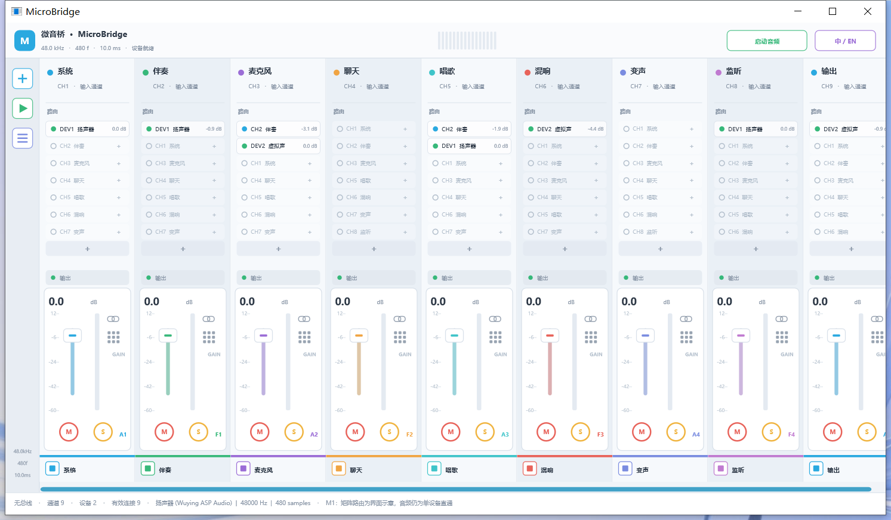

# 微音桥 MicroBridge

**简体中文** · **[English](README.md)**



> Windows 上的轻量**软件配线架**。没有固定总线：每条通道自己指定输入源与输出目标，
> 输出目标包含本机所有声卡驱动，也可以送进其他通道作为输入源。同时内置媒体播放器、
> 桌面歌词、内置效果链、全局快捷键与系统托盘模式。

**当前状态：pre-alpha，不可用于生产环境。** 仅 Windows x64。

---

## 功能特性

- **软件配线架（非调音台）**。路由是一张带增益的有向图，只有三类边 —— `P→C`（物理输入 →
  通道）、`C→C`（通道 → 通道）、`C→P`（通道 → 物理输出）。`A→B→A` 反馈环在建连时由拓扑检测
  直接拒绝。静音 = 断开全部出边；独奏 = 只保留独奏通道的出边。
- **本机所有驱动都能当输出目标**。输出菜单列出的是**全部已枚举驱动**的输出端口（不只是主
  设备）；路由到非主设备时按需懒打开为辅助设备，路由到其他通道时该通道就成为对方的一个输入源。
  没有任何连接再引用该设备时会自动关闭。
- **启动时选驱动**。首次启动弹出设备面板，列出全部可用驱动类型 —— **ASIO**（本构建已显式
  开启）、**WASAPI**（共享 / 独占 / 低延迟）、**DirectSound** —— 以及输入设备、输出设备、采样率、
  缓冲大小。选择持久化到 `%APPDATA%\MicroBridge\device.xml`，之后启动自动恢复。选好设备即出声，
  关闭程序才停止，界面里**没有任何「启动 / 停止」控件**。
- **内置通道效果（FX）**。单效果面板与整链模式涵盖 **噪声门（Noise Gate）、高通滤波（HPF）、
  均衡（EQ）、压缩器（Compressor）、激励驱动（Drive）、延迟（Delay）、混响（Reverb）、
  限制器（Limiter）**。每个内置插件上「旁通」与「重置」统一尺寸、贴底对齐。
- **媒体播放器插件**。在任意通道添加内置 **播放器**，即可把音频文件（MP3 / M4A·AAC / WMA /
  WAV / FLAC，经 Windows Media Foundation 解码）直接送入路由图播放。支持播放列表、上一曲 /
  下一曲、拖动定位，以及**后台播放**（主窗口隐藏或关闭到托盘后音频继续播放）。
- **桌面歌词**。悬浮、置顶的歌词窗口，颜色跟随当前歌词行；支持拖动 / 缩放、字号自适应，并提供
  **锁定**模式（鼠标穿透，可透过歌词区域操作其他应用）。隐藏 / 关闭按钮与播放器的「桌面歌词」
  开关同步。歌词读取自音频内嵌的 LRC 元数据。
- **全局快捷键**。可自定义的全局热键 —— 锁定 / 解锁桌面歌词（默认 `Ctrl+Alt+L`）、隐藏 /
  恢复窗口。
- **系统托盘**。可选托盘图标，支持「关闭时隐藏到托盘」「启动时最小化到托盘」以及快捷锁定 /
  解锁歌词。
- **设置项**。置顶、桌面歌词置顶、桌面歌词锁定状态、自定义解锁 / 锁定热键、隐藏热键与隐藏方式、
  `中 / EN` 即时语言切换。
- **通道联动**。将多条通道的推子联动，一起移动。
- **会话存储 / 录音 / 节点视图**。保存与恢复当前配线、把通道录制为文件、可视化路由图。
- **双语界面**。所有文案统一经 `Source/I18n.h`（`S()` / `tr()`，`CharPointer_UTF8`），
  中英切换即时生效。

命名：**微**＝占用低、延迟低，**音桥**＝音频桥接；中文 3 字，英文 `MicroBridge` 直译干净。

## 设计约束

- **轻量化优先**：不引入 AI 模型、ONNX Runtime、仅播放器使用的 Media Foundation *解码器*，
  也不随包安装虚拟声卡驱动。
- **C++20 + JUCE 8**：只使用设备 I/O、线程、GUI 与基础 DSP；JUCE **只引用、不复制**（见 `JUCE_DIR`）。
- **ASIO 说明**：JUCE 默认 `JUCE_ASIO=0`，本构建显式设为 `1` 并使用 JUCE 随附的 Steinberg ASIO SDK
  头文件。**ASIO SDK 有独立许可条款**，分发二进制前请自行核对 Steinberg 许可。
- **VST3 托管**已编译进构建（`JUCE_PLUGINHOST_VST3=1`）并经由插件机架暴露，但上述内置 FX 才是
  自包含的主要效果链。
- **与 S-Rack 完全独立**：只读取已有 JUCE 源码树，不依赖、不修改、不随包发布 S-Rack。

### 明确不做

时间线、多轨剪辑、编辑历史、离线导出、录音编辑、AI 人声分离、驱动安装、macOS / Linux。

## 界面概览

- **顶栏**：品牌、驱动类型胶囊、采样率 / 缓冲 / 延迟、主设备、LED 电平表、自动运行状态点、
  「设备设置」、「中 / EN」。
- **工具条**：通道 / 输入端口 / 输出端口 / 连接 / 辅助设备 / 欠载统计，以及 `+ 通道`、`清除连接`、`重置路由`。
- **通道条**（横向滚动）：**输入源区**（物理输入端口 + 其他通道，紫 / 蓝点）→ **输出目标区**
  （本机全部输出驱动 + 其他通道，绿 / 蓝点）→ 推子卡（dB 读数、电平表、`M` / `S`）。
  点 `+` 建立连接，点已有行改增益或移除。**播放器**与**内置 FX** 位于通道的插件区。
- **底栏**：操作提示与短暂反馈。

> **中文编码说明**：JUCE 8 的 `juce::String (const char*)` 按 ASCII 逐字节构造，裸传中文 UTF-8
> 字面量会显示成 `微音桥`。所有界面文案统一经 `Source/I18n.h` 的 `S()` / `tr()`
> 以 `CharPointer_UTF8` 包装，中英切换即时生效。

## 架构速览

`Source/RouteGraph.h` 是纯 C++20 内核、不依赖 JUCE。控制线程建图、检测环并编译成不可变
`ProcessingPlan`，通过 `atomic<shared_ptr<const Plan>>` 换出；音频回调只做乘加，
零分配、零锁、零图遍历。

`Source/AudioEngine.h` 以主设备为唯一处理主时钟；其他驱动各自创建 `AudioIODevice`，
用 SPSC 无锁环形缓冲 + 线性插值 + 慢速漂移修正（轻量 ASRC）桥接。
`Source/DeviceCatalog.h` 负责驱动 / 端口枚举与默认设备持久化。

端口映射同样编译成不可变快照 `PortRouting`，音频线程从不读取可变的设备目录。
详见 [docs/ARCHITECTURE.md](docs/ARCHITECTURE.md)。

## 已知限制

1. 每个驱动目前提供**两个立体声端口（L / R）**；通道数更多的设备只映射前两个，
   更细的逐通道路由留待后续。
2. 重新选择驱动会重新枚举端口，因此**路由会重置**（端口编号变化）。路由预设 / 完整持久化仍在打磨。
3. 多设备时钟漂移已用插值 + 自适应读指针处理，但**连续 30 分钟长跑的漂移与爆音仍需真机验证**；
   欠载 / 溢出计数显示在工具条。
4. 部分驱动不允许二次打开（尤其某些 ASIO 驱动）。这类端口会静音并在界面报告失败，**不做假连接**。
5. 辅助设备额外引入约 `max(1024, 4 × 缓冲)` 帧延迟（48 kHz 下约 21 ms）；主设备路径无额外缓冲。
6. 推送到 OBS 仍依赖外部虚拟声卡（VB-CABLE / Voicemeeter）；随包安装驱动涉及签名与权限，暂缓。

## 安装（Windows x64）

**便携化设计**：所有设置、会话、预设、设备选择都存放在 **exe 同级的 `MicroBridgeData` 文件夹**，
随程序走、不写注册表。因此程序必须安装在**用户可写**的位置。

**方式 A — 安装包（推荐）**
1. 从 Releases 下载 `MicroBridgeSetup-0.1.0.exe`，双击安装。
2. 默认装到 `%LOCALAPPDATA%\Programs\MicroBridge`（无需管理员权限），
   自动创建开始菜单与桌面快捷方式。
3. 卸载只删程序本体，`MicroBridgeData` 用户数据保留；要彻底清除需手动删除该文件夹。

**方式 B — 免依赖脚本**（没装 Inno Setup 时）：先按下方构建出 Release exe，然后
```powershell
powershell -ExecutionPolicy Bypass -File installer\Install.ps1        # 安装
powershell -ExecutionPolicy Bypass -File installer\Install.ps1 -Uninstall   # 卸载
```

**方式 C — 绿色版**：直接把 `MicroBridge.exe` 单独复制到任意可写文件夹即可运行，
首次启动会自动创建 `MicroBridgeData`。

> 维护者可用 `installer/MicroBridge.iss` 通过 Inno Setup 6 重新编译安装包：
> `ISCC.exe installer\MicroBridge.iss`，产物在 `installer\Output\`。

## 构建（Windows x64）

依赖：MSVC 14.5x、Windows SDK 10.0.26100.0、CMake ≥ 3.22、Ninja，以及一份 **JUCE 8.x** 源码树。
`build.bat` 手工设置 `INCLUDE` / `LIB` / `PATH`（不调用 `vcvarsall`）；`build_fast.bat` 为便捷增量构建。

```bat
build.bat
build\RouteGraphTest.exe
:: 或
ctest --test-dir build -V
```

JUCE 默认路径 `D:/Xiangmu/S-Rack/ThirdParty/juce-8.0.15`，换机器时覆盖：

```bat
build.bat -DJUCE_DIR="C:/path/to/juce-8.0.15"
```

产物：

```
build/MicroBridgeApp_artefacts/Release/MicroBridge.exe
build/RouteGraphTest.exe
```

## 目录结构

```
Source/RouteGraph.h        路由内核（纯 C++20，实时安全快照）
Source/DeviceCatalog.h     驱动 / 端口枚举 + 默认设备持久化
Source/AudioEngine.h       主时钟、辅助设备、无锁环形缓冲、plan 执行
Source/DeviceSetup.h       启动 / 运行时设备选择层
Source/ChannelStrip.h      通道条（输入源 / 输出目标 / 推子）
Source/ChannelFx.h         内置 FX 定义（门/HPF/EQ/压缩/驱动/延迟/混响/限制器）
Source/FxPanel.h           单效果 + 整链 FX 界面（旁通 / 重置布局）
Source/MediaPlayer.h       播放器引擎
Source/MediaPlayerPanel.h  播放器界面 + 桌面歌词集成
Source/Lyrics.h            LRC 解析
Source/EmbeddedLyrics.h    内嵌歌词提取
Source/DesktopLyrics.h     悬浮桌面歌词窗口
Source/GlobalHotkey.h      全局热键引擎
Source/ChannelLinks.h      通道推子联动
Source/SessionStore.h      保存 / 恢复当前配线
Source/ChannelRecorder.h   通道录制为文件
Source/NodeView.h          路由图可视化
Source/PluginRack.h        VST3 插件托管界面
Source/SettingsPanel.h     设置 + 热键配置
Source/AppSettings.h       设置持久化
Source/MainComponent.h     顶栏 / 工具条 / 通道条容器 / 托盘 / 底栏
Source/I18n.h              UTF-8 安全的双语词表
Source/Theme.h             浅色配线架主题、增益换算
Source/Main.cpp            应用入口
Tests/RouteGraphTest.cpp   路由内核测试（无需 JUCE）
docs/PRD.md                产品需求与里程碑
docs/ARCHITECTURE.md       模块设计与实时约束
```

## 命名说明

`MicroBridge` 在 GitHub 上有若干无关的 Arduino 时代同名项目，国内也有公司字号含「音桥」。
作为开源产品名可用；若要注册商标，请先在中国商标网做第 9 / 42 类近似查询。
以上为公开网络检索，不构成法律意见。
